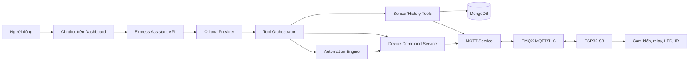

# Kiến trúc AI Smart Home Assistant

## Luồng tổng quát

## Các lớp

- `ai/providers/ollamaProvider.js`: adapter LLM. Provider được chọn bằng `AI_PROVIDER`; hiện triển khai Ollama.
- `ai/assistantService.js`: vòng lặp Tool Calling, ngữ cảnh hội thoại, pending confirmation và giới hạn số vòng tool.
- `ai/toolDefinitions.js`: schema tool gửi cho model.
- `ai/toolRegistry.js`: allowlist và triển khai tool; LLM không được gọi hàm ngoài registry.
- `services/deviceCommandService.js`: xác thực lệnh, kiểm tra online, chặn an toàn, chống lệnh trùng và chờ trạng thái MQTT.
- `services/automationEngine.js`: chạy quy tắc sensor/time và lịch hẹn không phụ thuộc LLM.
- `services/sceneService.js`: các kịch bản có thể sửa trong MongoDB.

## Mô hình trạng thái

Hệ thống phân biệt:

1. `desiredDeviceStatus`: trạng thái backend vừa yêu cầu.
2. `currentDeviceStatus`: trạng thái ESP32 đã báo qua MQTT.
3. Trạng thái vật lý: chỉ được xem là kiểm chứng với relay/LED mà ESP32 đọc/báo lại. Điều hòa IR một chiều luôn có `physicallyVerified=false`.

## An toàn và xung đột

- Manual Dashboard, AI, automation, schedule và scene dùng cùng lớp điều khiển.
- Lệnh trùng cho cùng thiết bị/trạng thái dùng chung một promise đang chờ.
- Automation có `cooldownSeconds`, `priority` và bỏ qua hành động xung đột với quy tắc ưu tiên cao hơn trong cùng chu kỳ.
- Không cho nguồn AI/automation/schedule/scene bật quạt khi cảm biến đang báo khói/khí gas.
- Cảnh báo tại ESP32 không bị AI vô hiệu hóa.

## Thiết bị đã xác nhận

Firmware tích hợp xác nhận DHT11, MQ-2, cảm biến ánh sáng, radar hiện diện, relay quạt, LED1–3, còi, LED cảnh báo, LCD và IR. Không có cảm biến ngọn lửa trong source hiện tại. Vị trí phòng của các LED chưa được xác nhận và phải cấu hình bằng `DEVICE_LABELS_JSON` sau khi kiểm tra dây.
